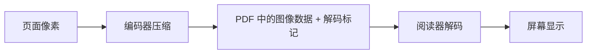
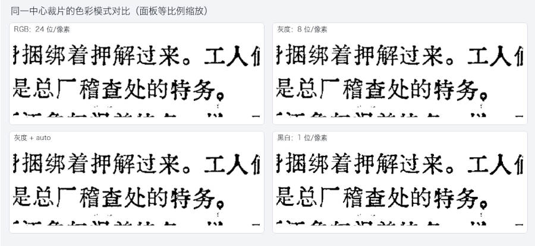
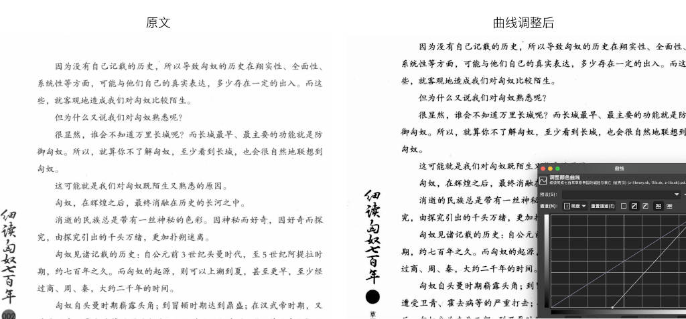
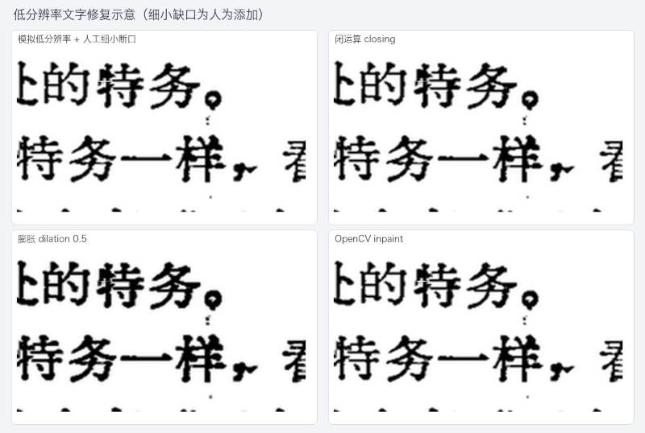
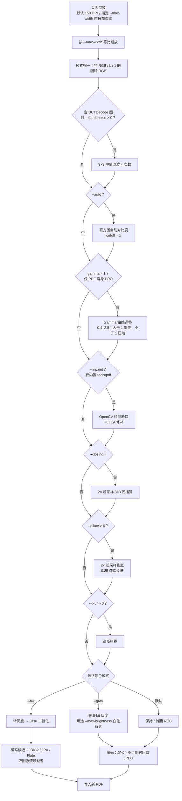

# 扫描 PDF 为什么这么大、字迹为什么不清：从颜色、分辨率到笔画修复

很多扫描 PDF，翻开一看，每一页其实就是一张图。黑字白底的页面如果还按 RGB 保存，三个颜色通道里往往塞着一大堆重复信息，这也是文件动不动就几十 MB 的常见原因；再加上放大、模糊或者有损压缩，细小笔画还可能断开、发虚。一个管体积，一个管看着清不清楚，这个工具两头都会照顾到。

下面介绍 MyBooks 现在的 PDF 图像处理工具具体怎么做，主要针对扫描页、或者整页都是图片的 PDF。它一边靠颜色模式转换和编码选择把体积压下来，一边用自动对比度、闭运算、膨胀和 inpaint 让文字更清楚、把断掉的笔画补一补。要注意，这个工具会把每页先渲染成图再写进新 PDF，所以要是你得保留可选中文字、搜索复制或者矢量图，它就不太合适了。

## PDF 里的图是怎么存、怎么显示的

一个 PDF 页面里，可能同时有能选中的文字、矢量图形和栅格图像。扫描仪扫出来的页面，基本都是栅格图像, 即每个像素记一个颜色或者亮度值。

存图的时候，编码器先把像素数据压成字节，PDF 里再记一笔用的是什么编码方式。阅读器打开页面，照着记录去找对应的解码器，把像素还原出来显示。`DCTDecode`、`JPXDecode` 这些是 PDF 里的图像解码标记，不是页面类型。

不同编码器在文件大小、画质和兼容性上各有取舍。但如果一个灰度页面硬是按 RGB 存，三个通道记的亮度信息其实差不多，这种冗余换编码器是去不掉的，只有转成灰度才行。

## 一份扫描 PDF 的内部结构

要看懂编码器，先得知道它在 PDF 里处在什么位置。PDF 不是“一张图片”，而是一套带着对象、索引和绘图指令的文件格式，可以分两层来看。

文件层面，PDF 是一串对象，加上一张记录对象位置的交叉引用表（xref）。每个对象有编号，阅读器靠 xref 找到它；末尾的 `startxref` 给出 xref 的位置，trailer 里则记着根对象 Catalog。PDF 1.5 之后，对象和 xref 也可以压进对象流和 xref 流里，但逻辑没变：先找 Catalog，再顺着引用往下找。

文档层面，Catalog 指向页面树（Pages），树的每个叶子是一页（Page）。一页通常带三样东西：

- `/MediaBox`：页面尺寸，单位是 PDF point（1/72 英寸）。
- `/Resources`：这一页能用的资源，字体、图像 XObject 都登记在这里。
- `/Contents`：一段内容流，本质是一串绘图指令。

内容流是 PDF 的“画布脚本”，用操作符描述“把什么画在哪”：`q`/`Q` 保存和恢复状态，`cm` 做坐标变换，`Do` 调用资源里的对象。原生文字页会用字体操作符逐段画字；扫描页则简单粗暴——整页往往只有一条“把这张图缩放铺满页面”的指令。

被 `Do` 调用的图像，是一个图像 XObject。它的字典里记着这张图的关键参数，流里才是压缩后的像素字节：

| 字典键 | 作用 |
| --- | --- |
| `/Width`、`/Height` | 像素尺寸 |
| `/ColorSpace` | 颜色模式：`DeviceRGB`、`DeviceGray`、`Indexed` 等 |
| `/BitsPerComponent` | 每个通道的位数，1 就是二值 |
| `/Filter` | 解码标记，比如 `DCTDecode`、`JPXDecode` |
| `/DecodeParms` | 解码参数，比如预测器或 CCITT 的 `/K` |
| 流数据 | 压缩后的像素字节 |

所以“扫描 PDF”通常长这样：每页一个图像 XObject，加一条把它铺满页面的内容流；如果做过 OCR，还会多一层不可见的文字，用来支持搜索和复制。颜色模式对应 `/ColorSpace` 和 `/BitsPerComponent`，编码器对应 `/Filter`，分辨率则体现在 `/Width`、`/Height` 跟 `/MediaBox` 的比例上。

工具会把嵌入图像的编码、DPI、像素尺寸和颜色模式列出来，方便查看。

## 第一步：确认内容的颜色模式

RGB 图里每个像素都带红、绿、蓝三个通道。灰度图只记一个亮度值；黑白二值图更省，每个像素非黑即白。

下面以测试图片中间的一小块做个同区域对比。面板为了展示做过等比例缩放；这里看的是颜色模式的差别，不代表压缩后的 PDF 文件大小。

再以一张 **2000 × 3000 像素**的页面为例，按 1 MB = 1,000,000 字节计算，未压缩像素数据的理论占用量如下：

| 模式 | 每像素数据量 | 该页面的理论数据量 | 相对 RGB |
| --- | ---: | ---: | ---: |
| RGB 彩色 | 24 bit（3 个 8-bit 通道） | 约 18 MB | 100% |
| 灰度 | 8 bit | 约 6 MB | 约 33% |
| 黑白二值 | 1 bit | 约 0.75 MB | 约 4% |

实际 PDF 还会再走一遍压缩，最终大小不会严格按这个比例来；但这张表至少说明了一件事：**先把不需要的颜色通道砍掉，往往是最划算的第一步**。本来就是黑字白底的页面，转灰度一般能明显减少图像数据；要是页面里没有照片、灰色插图或者浅色文字，也可以再试试黑白二值化。

- `--gray`：保留亮度层次和抗锯齿边缘，适合文字偏浅、带灰色插图，或者希望画面看起来自然一点的页面。
- `--bw`：把页面转成 1-bit 黑白图，适合背景干净、文字对比明显的页面。不过浅色细笔画可能会被抹掉，图片和灰色内容也会丢掉层次。注意，1 通道（`bpc=1`，通常带 `Indexed` 调色板）的页面会被强制二值化，阈值规则见下文「二值化阈值」。

顺带解释一下 `--bw` 背后的 **Otsu（大津法）**：它由大津展之于 1979 年提出，做法是统计整页的灰度直方图，从 0 到 255 里挑一个阈值，让分出来的“墨”和“纸”两类像素差异最大。好处是不用人工指定阈值，普通灰度扫描页直接就能用；代价是遇到 90% 以上都是纸白的页面，阈值容易被推得偏高，这一点在后面的「二值化阈值」里细说。

## `--auto` 的作用

现在的 `--auto` 会看直方图自动调对比度：先忽略掉少量极端像素，再把亮度范围拉开。它可能让纸张背景更接近统一的白色、让文字更清楚，也能减少背景变化对压缩的干扰。

但注意，`--auto` **不会把 RGB 变成灰度，也不会把 8-bit 灰度变成 1-bit 黑白**，所以它算不上削减颜色数据的主力；对文件大小的影响完全看原图，不保证一定变小。纸张上的污渍、噪点也可能被一起放大。稳妥的做法是先把 `--gray` 和 `--auto --gray` 的预览摆一起看，再决定要不要留自动校正。

压缩能省下来的部分，通常来自三个层面：

| 顺序 | 处理 | 主要作用 | 对文件大小的影响 |
| --- | --- | --- | --- |
| 1 | RGB 转灰度，或灰度转黑白 | 减少每个像素需要保存的数据 | 通常是最大的潜在收益；取决于内容是否适合转换 |
| 2 | `--auto` 对比度校正 | 调整背景和文字的亮度分布 | 可能让背景更规整，但收益因页面而异 |
| 3 | 选择编码器及质量 | 对已经选定的像素数据进行压缩 | 进一步缩小文件；有损压缩可能带来画质损失 |

## 二值化阈值：一个不显眼的默认值就能让字变粗

`--bw` 背后是 Otsu。1 通道（`bpc=1`，通常带 `Indexed` 调色板）的页面还有一条隐藏规则：不管选灰度还是彩色，都会被强制二值化，所以这类页面的“灰度预览”实际执行的是黑白二值化。

问题出在阈值。这类页面 90% 以上是纸白，Otsu 的类间方差会被占多数的纸色拉高，一页可能算出 **152**，而黑白的中点是 **128**。多出来的 24 级正好落在抗锯齿边缘上，边缘像素大面积被压黑，字就变粗、笔画粘连，小字甚至糊掉。

| 同一页、同一渲染（1024 宽） | 墨色覆盖率 |
| --- | ---: |
| 原图 | 5.60% |
| Otsu 阈值（152） | 6.24%（+11.5%） |
| 黑白中点（128） | 5.60% |

## PDF 里常见的图像编码器

前面一直说“编码器”，这里把它们拆开讲讲。PDF 里的编码器就是 `/Filter` 里的解码标记，阅读器看到哪个标记，就调用哪个解码器。选编码器，其实就是给不同内容挑合适的压缩方式。

**FlateDecode（zlib / DEFLATE）**：通用的无损压缩，PNG 用的也是它。实现简单、兼容性好，适合二值图、灰度图、截图和带透明通道的图。缺点是只做通用压缩，对连续色调照片的压缩率一般；扫描页如果只挂 Flate，文件往往还不够小。

**DCTDecode（JPEG）**：最熟悉的 JPEG，基于 8×8 块的离散余弦变换和量化。它有损、压缩率高，适合照片和连续色调的灰度扫描页。代价是块效应和振铃，文字边缘容易出现“蚊状”杂边，小字尤其明显。好处是兼容性最好，几乎所有阅读器都认识。

**JPXDecode（JPEG 2000）**：基于小波变换和 EBCOT，有无损和有损两种模式，压缩率通常比 JPEG 好，还支持渐进传输和感兴趣区域。它适合灰度、彩色扫描页，也适合需要可逆压缩的场合。短板是解码支持不如 JPEG 普遍，有损模式压缩过头会发糊，编码也更慢。

**JBIG2Decode**：专攻 1-bit 黑白图，用上下文算术编码，还能把重复出现的字形存成符号字典反复引用，所以整页文字的黑白扫描件能被压得很小。它本身有有损、无损两种用法：有损模式会替换或复用相似字形，可能“改字”；MyBooks 调 jbig2enc 生成的是无损 generic region。兼容性上，现代阅读器一般没问题，老工具或某些归档规范可能不认。

**CCITTFaxDecode（CCITT G3/G4）**：传真时代的标准，只处理 1-bit 黑白。G3（T.4）是逐行游程编码，G4（T.6）是纯二维编码，压缩率更好。它的优势是无损、实现简单、兼容性极好，很多老扫描仪和传真归档文件都用它，PDF 里用 `/K` 参数区分 G3/G4。对普通文字页，它通常比 Flate 小，但一般比 JBIG2 大。MyBooks 目前没有输出 CCITT：JBIG2、JPX、Flate 比下来通常更小，CCITT 的价值更多在兼容老文件。

**LZWDecode / RunLengthDecode**：两位老将。LZW 在早期 TIFF/PDF 里常见，专利过期后基本被 Flate 取代；RunLength 适合大面积同色，压缩率有限，现在更多出现在简单或遗留数据里。一般不用主动选它们。

| 编码器 | 压缩方式 | 典型内容 | 兼容性 | 本工具是否输出 |
| --- | --- | --- | --- | --- |
| FlateDecode | 无损 | 二值、灰度、截图 | 好 | 是，黑白页的兜底候选 |
| DCTDecode | 有损 | 彩色 / 灰度照片 | 最好 | 是，JPEG 2000 不可用时回退 |
| JPXDecode | 有损 / 无损 | 灰度、彩色扫描页 | 较好 | 是，彩色 / 灰度默认 |
| JBIG2Decode | 有损 / 无损 | 黑白文字页 | 较好，需解码器支持 | 是，黑白候选（无损生成） |
| CCITTFaxDecode | 无损 | 黑白文字页、传真 / 老扫描件 | 最好 | 否 |
| LZWDecode / RunLengthDecode | 无损 | 遗留数据 | 一般 | 否 |

想确认手里的 PDF 具体用了哪种编码，可以先用 `--inspect` 看一眼，再决定要不要动它。

## 编码器怎么选：看页面模式和用途

MyBooks 的做法是：先定下页面最后是彩色、灰度还是 1-bit 黑白，再根据环境里有什么能力来挑编码方式。

| 页面类型 / 条件 | PDF 解码标记 | 当前工具的做法 | 取舍 |
| --- | --- | --- | --- |
| 彩色或灰度，Pillow 支持 JPEG 2000 | `JPXDecode` | 默认使用 JPEG 2000；可按质量压缩，也可用 `--lossless` 选择可逆编码 | 有损模式通常更小；可逆模式不新增有损压缩误差，但文件可能更大 |
| 彩色或灰度，JPEG 2000 不可用 | `DCTDecode` | 回退到 JPEG 编码 | 兼容性广；属于有损压缩 |
| 1-bit 黑白 | `JBIG2Decode`、`JPXDecode` 或 `FlateDecode` | 若找到 `jbig2`（jbig2enc），就把可用编码结果按图像数据流长度比较，并选最短的一个 | 这些候选在当前实现中按无损方式生成；最终仍以实际图像内容和编码结果为准 |

`--quality` 只对有损的 JPEG 2000 / JPEG 路径生效；走可逆 JPEG 2000 模式时，质量值是不起作用的。另外，工具比较黑白图像时，比的是各编码候选的图像数据流长度，并不等于给最终 PDF 的总大小打包票。

编码器只是把已有的像素数据再压一遍，替代不了颜色模式转换。对很多黑白扫描页来说，先把 RGB 转成灰度或黑白，通常比单纯换个编码器更能减少要编码的数据。

## 分辨率：增加像素不等于找回细节

DPI 说的是每英寸塞多少像素。页面宽 8.5 英寸，按 150 DPI 渲染，图像宽度就是 `8.5 × 150 = 1275` 像素左右。

工具默认按 150 DPI 渲染。如果一页就是一整张扫描图，而且原图分辨率不到 150 DPI，它会按原图那个更低的分辨率来，免得白白放大。要是你指定了 `--max-width`，就按目标像素宽度渲染，不再走默认 DPI 那套。

- 对 PDF 里的文字和矢量线条来说，提高渲染分辨率，栅格化时就能生成更多像素。
- 对本来就低分辨率的扫描图，提高 `--max-width` 只是插值放大，扫描时没记下来的笔画细节回不来。
- 而且分辨率一提，像素数量也跟着涨，文件未必更小；还是得拿阅读设备和实际字迹清不清晰来掂量。

分辨率决定生成多少像素，编码器决定怎么压这些像素。

## Closing 和 Dilation：救的是断笔，不是还原原始笔画

缩放、模糊或者有损压缩，都可能让细小笔画断掉。对黑字白底的图来说：

- **Closing（闭运算）**先把暗色笔画撑开，再把边缘收回去，用来连接挨得很近的断笔、填上细小的缺口。
- **Dilation（膨胀）**则是直接撑粗暗色笔画，让细的稍微粗一点。它不分青红皂白，所有暗色内容都会变粗，力度一大字形就发浓，甚至会把相邻的字粘一起。

现在的处理器会先把图像放大 2 倍做形态学操作，再缩回原尺寸；`--dilate 0.5` 对应的就是原图 0.5 像素的膨胀半径。超采样能把调整做得更细，但不一定对所有字号都合适。它同样可能把小字的字腔填死，所以先预览几页再说。

上图是**人为造出来的模拟损伤**：测试裁片先降采样，再擦掉一小段笔画。它只是用来看处理前后的差异，不代表每份 PDF 都会这样。Closing 可能把缺口补上，也可能把字腔挤小；dilation 是整体加粗，做不到只修某一处。

`--inpaint` 是另一条补全思路：装了可选的 OpenCV 后，它会根据局部闭运算找出候选断口，再用周围的像素去估算缺失区域；现在的实现会把跟外部背景不连通的封闭区域排除掉，降低把字腔填掉的风险。它适合拿来做预览验证，但不是 OCR，也猜不出被破坏的字原本是什么。

## 扩散模型修复：效果更猛，但算力门槛也高

最近两年，一批基于扩散模型（diffusion model）的文档修复方案冒了出来，思路和前面的形态学操作完全不是一回事：不是拿固定规则去补断笔，而是让模型先学“干净文档长什么样”，再从退化的图里把细节“生成”回来。

几个常被提到的代表：

| 方案 | 侧重 | 大致显存需求 | 单页耗时（GPU） | 备注 |
| --- | --- | --- | --- | --- |
| DocDiff | 文档去模糊、去噪、二值化 | 8 GB 级 | 几秒到十几秒 | 文档专用，按 patch 推理 |
| DiffBIR | 盲修复，老照片、重度退化扫描件 | 10 GB 以上 | 十几秒起 | 借 Stable Diffusion 先验，高分辨率要分块 |
| SUPIR | 照片级还原 | 16–24 GB | 几十秒 | 基于 SDXL，效果强但最重 |

MyBooks 目前没有把扩散模型修复纳入处理流程：一是算力要求和现在的定位不匹配，二是文档场景对“不能改字”的容忍度很低，生成式修复还需要额外的校验手段才敢用。短期内更现实的做法，还是先把颜色模式、分辨率和编码选对，再用 closing、dilation、inpaint 做保守修补。

## 一张图看完整个处理流程

把上面这些参数按代码里的实际顺序串起来，大概是这样：

几个图里没展开的细节：`gamma`（0.4–2.5，1 为原样，大于 1 提亮、小于 1 压暗）和 1-bit 源取中点目前只在 PDF 瘦身 PRO 里；`--inpaint` 和默认关闭的开运算（`ENABLE_OPENING`）属于内置 `tools/pdf`。`--skip-pages` 两边都会跳过大部分图像处理（`--dct-denoise` 除外），但页面仍会重新渲染和编码；颜色模式始终是最后一步，前面的对比度、gamma、形态学操作都作用在原始颜色模式上。
